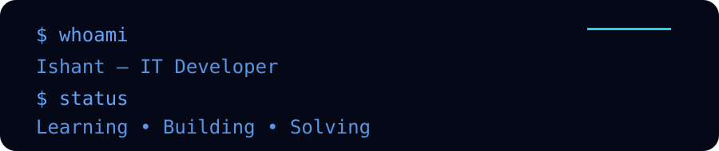

<!-- Ishant | GitHub Profile -->

  
   
  
    
  
  
  

<table>
  <tr>
    <td width="70%" valign="middle">
      <h2>Hey, I'm Ishant 👋</h2>
      
I'm a BTech Information Technology student who learns by making things. I enjoy taking an idea from a rough sketch to a working project, then improving it one detail at a time.

      
🔭 <strong>Building:</strong> a browser based code editor with TypeScript and React 
      🌱 <strong>Learning:</strong> C++, data structures, algorithms, Python, and modern web development 
      🎯 <strong>Focus:</strong> solid fundamentals, thoughtful interfaces, and useful projects

      
<a href="https://github.com/ITIshu?tab=repositories">Browse my projects →</a>

    </td>
    <td width="30%" align="center" valign="middle">
      
       Looping GIF · silver X-ray scan sweep · orbiting bubbles
    </td>
  </tr>
</table>

  

## 🧭 What I'm working on

| Area | Current focus |
|:--|:--|
| **Problem solving** | Strengthening C and C++ fundamentals, then applying them to data structures and algorithms. |
| **Python** | Building confidence through small, practical exercises and projects. |
| **Web development** | Learning TypeScript and React while building a code editor for the browser. |

## 🧰 My toolkit

<strong>Languages</strong> 

<strong>Web and workflow</strong> 

## 🚀 Featured project · VS-code

<table>
  <tr>
    <td width="62%" valign="top">
      <h3>A code editor for the browser</h3>
      
A TypeScript project exploring the building blocks of a developer workspace, including syntax highlighting, IntelliSense, a file explorer, search and replace, and more.

      
  

      
<a href="https://github.com/ITIshu/VS-code">View source ↗</a> &nbsp;·&nbsp; <a href="https://fancy-pony-6e50b4.netlify.app/">Open live demo ↗</a>

    </td>
    <td width="38%" align="center" valign="middle">
      
    </td>
  </tr>
</table>

## 📈 GitHub activity

  
  
    
  

Language statistics reflect public repository code, not a measure of skill.

## 🐍 Contributions in motion

  <picture>
    <source media="(prefers-color-scheme: dark)" srcset="https://raw.githubusercontent.com/ITIshu/ITIshu/gh-pages/github-contribution-grid-snake-dark.svg" />
    <source media="(prefers-color-scheme: light)" srcset="https://raw.githubusercontent.com/ITIshu/ITIshu/gh-pages/github-contribution-grid-snake.svg" />
    
  </picture>

## 🤝 Let's connect

  <a href="https://github.com/ITIshu?tab=repositories">Repositories</a> &nbsp;·&nbsp;
  <a href="https://www.linkedin.com/in/ishant-saraogi-0488b735b/">LinkedIn</a>
    
  <strong>Learn something. Build something. Make it better.</strong>

